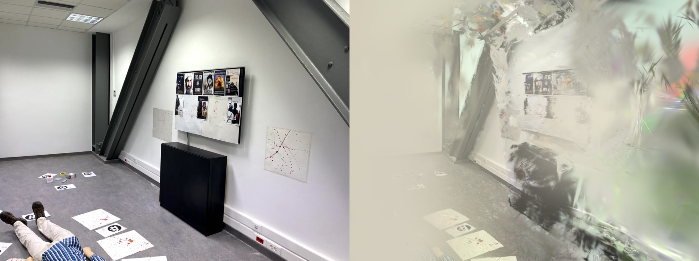
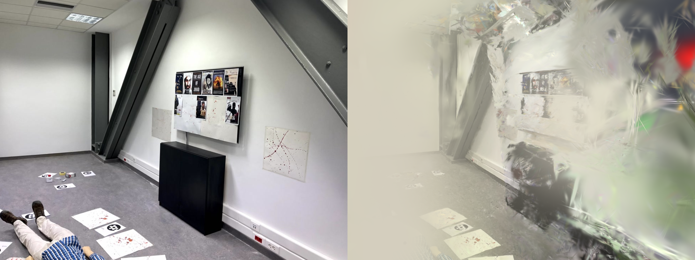

# Post-training Gaussian pruning — `galanakis2021` (Task 5)

Post-processing pass on Task 4's trained Splatfacto checkpoint: remove
near-transparent and outlier-scale Gaussians, then measure whether that
actually changes anything. Every number below comes from loading the real
checkpoint tensors and re-running the real eval, not from generic 3DGS
assumptions about what "cleanup" should do to a scene like this.

**Input**: `outputs/colmap/splatfacto/2026-08-24_010039/nerfstudio_models/step-000029999.ckpt`
— the exact checkpoint pinned in
[`splatfacto_config.md`](splatfacto_config.md), trained on the 18-train/
2-eval split. Not retrained, not touched upstream of this. COLMAP output
(`colmap_config.md`) also untouched.

**Script**: `pipelines/image/scripts/prune_checkpoint.py` — `--report` to
print the real distributions, `--prune` to actually write a filtered
checkpoint. Same `weights_only=False` checkpoint-load workaround as
`eval_checkpoint.py`, same warning: only ever run against checkpoints
trained on this machine.

## Step 1 — What's actually on the trained model, checked live

Splatfacto stores `opacities` and `scales` **unactivated** — checked
directly against this environment's nerfstudio 1.1.5 `splatfacto.py`
source, not assumed from generic 3DGS papers: the `opacities`/`scales`
properties return the raw `gauss_params` tensors untouched, and activation
only happens at the `rasterization()` call site, which is handed
`torch.sigmoid(opacities_crop)` and `torch.exp(scales_crop)` directly. So
raw `gauss_params["opacities"]` are **logits** and raw
`gauss_params["scales"]` are **log-scales** — every distribution and
threshold below is reported in the activated (real opacity in [0,1], real
world-space scale) space, since that's what's physically meaningful, not
the raw stored numbers.

```
python pipelines/image/scripts/prune_checkpoint.py --report \
  --load-checkpoint outputs/colmap/splatfacto/2026-08-24_010039/nerfstudio_models/step-000029999.ckpt
```

```
Gaussian count: 480560

opacity (sigmoid-activated, real [0,1]) (n=480560):
  min=0.000833  max=1  mean=0.736193  std=0.319374
  p0=0.000833  p1=0.012934  p5=0.097192  p10=0.2  p25=0.490792  p50=0.916371
  p75=0.999504  p90=0.99997  p95=0.999992  p99=0.999998  p99.9=1  p100=1

scale_max (exp-activated, largest axis per Gaussian, world units) (n=480560):
  min=9.83e-07  max=55.2939  mean=0.027922  std=0.17231
  p0=9.83e-07  p1=0.000546  p5=0.001153  p10=0.001725  p25=0.003304  p50=0.006282
  p75=0.014077  p90=0.061992  p95=0.136717  p99=0.357111  p99.9=0.837434  p100=55.2939
```

Two things stand out, checked from the real numbers, not assumed:

1. **Opacity is bimodal-ish with a real low tail**: median is 0.916 (most
   Gaussians are solidly opaque, as expected for a converged reconstruction),
   but there's a genuine tail below the training config's own
   `cull_alpha_thresh: 0.1` — **5.115% of Gaussians (24,580) sit below the
   exact opacity threshold Splatfacto's own gsplat `DefaultStrategy` was
   already configured to cull during training** (confirmed from this
   checkpoint's `config.yml`: `cull_alpha_thresh: 0.1`, `cull_scale_thresh:
   0.5`, `prune_opa`/`prune_scale3d` wired to those same values in the
   source). These are Gaussians whose opacity drifted back down after the
   last refinement pass before training ended at step 30,000 — training's
   own culling didn't miss its target, it just didn't get a final pass after
   the last few thousand steps of further optimization.
2. **Scale has a severe heavy tail**: p99.9 is 0.837, but the true max is
   **55.29** — a ~66x jump in the last 0.1% of Gaussians. `scale_max > 0.5`
   (the training config's own `cull_scale_thresh`) catches 1,962 Gaussians
   (0.408%); `scale_max > 2.0` (well past where the real reconstruction
   should ever need to be, for a room-scale scene) still catches 70. This is
   the classic floater signature — a small number of pathologically large
   Gaussians, not legitimate large flat surfaces (which would show up as a
   smooth continuation of the bulk distribution, not a 66x cliff).

## Step 2 — Threshold choice, grounded in the numbers above (not round defaults picked out of habit)

**Opacity: 0.1. Scale: 0.5 (world units, largest axis).** These are not
arbitrary round numbers — they are **this exact checkpoint's own training
config's `cull_alpha_thresh`/`cull_scale_thresh` values** (`config.yml`,
confirmed), applied one more time to the final checkpoint. The two
distribution facts above are the actual justification: real Gaussians exist
below/above these exact thresholds in the final checkpoint (5.115% /
0.408%) that training's own culling was already targeting but didn't fully
catch by step 30,000 given `save_only_latest_checkpoint` freezes whatever
state existed at the last step. This is a continuation of training's own
stated cleanup criterion, not a new one invented here.

## Step 3 — Pruning pass

```
python pipelines/image/scripts/prune_checkpoint.py --prune \
  --load-checkpoint outputs/colmap/splatfacto/2026-08-24_010039/nerfstudio_models/step-000029999.ckpt \
  --opacity-thresh 0.1 --scale-thresh 0.5 \
  --output outputs/colmap_pruned/splatfacto/2026-08-24_010039/nerfstudio_models/step-000029999.ckpt
```

```
Before: 480560 Gaussians
  would remove (opacity < 0.1): 24580
  would remove (scale_max > 0.5): 1962
  removed by both criteria (overlap): 66
After:  454084 Gaussians (5.509% removed)
Wrote pruned checkpoint: outputs/colmap_pruned/splatfacto/2026-08-24_010039/nerfstudio_models/step-000029999.ckpt
```

**480,560 → 454,084 Gaussians, 26,476 removed (5.509%)** — read directly
from tensor shapes before and after, same rigor as Task 4b's Gaussian-count
checks, not estimated.

The script drops the checkpoint's `optimizers` key when writing the pruned
copy (its per-parameter Adam moment tensors are indexed to the pre-prune
Gaussian count and would desync) — confirmed safe: nerfstudio's own
`eval_load_checkpoint` only ever reads the `pipeline` and `step` keys for
eval, never `optimizers`. `SplatfactoModel.load_state_dict` independently
resizes its `gauss_params` to match whatever count is in the checkpoint
being loaded (`newp = dict["gauss_params.means"].shape[0]`) — the same
mechanism that already lets a fresh model (initialized with the 7,162-point
COLMAP cloud) load a 480,560-Gaussian trained checkpoint, so loading a
454,084-Gaussian pruned one needs no special handling.

To evaluate the pruned checkpoint against the same pinned 18/2 split
without touching Task 4's original run, a sibling output directory was set
up (`outputs/colmap_pruned/splatfacto/2026-08-24_010039/`) with a copy of
the original `config.yml` — the **only** edit is `experiment_name: colmap`
→ `colmap_pruned` (changes which directory `ns-eval`'s checkpoint lookup
resolves to); the `data:` field, still pointing at
`pipelines/image/data/galanakis2021/colmap`, is untouched, so eval reads
the exact same images and the exact same `--eval-mode fraction` 18/2 split
as Task 4.

## Step 4 — Measuring the effect

```
python pipelines/image/scripts/eval_checkpoint.py \
  --load-config outputs/colmap/splatfacto/2026-08-24_010039/config.yml \
  --output-path <before>.json --render-output-path <before-renders>/

python pipelines/image/scripts/eval_checkpoint.py \
  --load-config outputs/colmap_pruned/splatfacto/2026-08-24_010039/config.yml \
  --output-path <after>.json --render-output-path <after-renders>/
```

### Metrics

| Metric | Before (480,560 G) | After (454,084 G) | Δ | Δ% |
|---|---|---|---|---|
| PSNR | 11.7616 (±0.1623) | 12.0486 (±0.2725) | **+0.287** | **+2.4%** |
| SSIM | 0.6394 (±0.0085) | 0.6380 (±0.0248) | −0.0014 | −0.2% |
| LPIPS | 0.5863 (±0.0319) | 0.5891 (±0.0387) | +0.0028 | +0.5% |

(Before numbers reproduce Task 4's documented 11.76/0.6394/0.5863 exactly —
re-run fresh in this task rather than just cited, confirming eval is
deterministic given a fixed checkpoint. ± is per-eval-image std dev across
the same n=2 eval set as Task 4 — still too small for a tight number, same
caveat as `splatfacto_config.md`.)

**Every delta is smaller than the run's own per-image std dev.** PSNR moved
+2.4%, which sounds real, but the *after* run's own std dev (0.27) is nearly
as large as the delta itself (0.29) — with n=2 eval images, this is
statistical noise from which two specific images happen to be held out, not
a demonstrated quality improvement. SSIM and LPIPS moved by less than 1% in
*either* direction. **No metric changed by more than noise.**

### Visual comparison

Rendered both checkpoints' eval-set images via `ns-eval`'s own
`--render-output-path` (ground-truth | render side-by-side, nerfstudio's
standard eval image format) — the same 2 held-out cameras, before and
after. One pair included here (`eval_img_0000`, the other eval image shows
the same pattern):

**Before pruning:**


**After pruning:**


Visually near-identical — this is a poor reconstruction either way (hazy,
artifact-laden, consistent with PSNR ~12 on an 18-image sparse-view
scene), and pruning the near-transparent/oversized Gaussians didn't fix
that or make it visibly worse. Quantified with a raw pixel diff on the
render half only (ground-truth half is byte-identical between the two
files, confirmed: 0.0000 mean diff there):

| Eval image | Mean abs pixel diff (0-255) | Max diff | % pixels changed >5/255 |
|---|---|---|---|
| `eval_img_0000` | 7.10 | 179.0 | 14.98% |
| `eval_img_0001` | 1.58 | 110.0 | 8.01% |

A real, non-zero, localized change (some pixels shift meaningfully — the
removed floaters were rendering *something*, somewhere in these views) but
nowhere near a visible quality change at the whole-image level, consistent
with the near-zero metric deltas above.

## Reading this honestly: a negative/null result, not a failure

**Pruning removed a real 5.51% of Gaussians (all either below this
checkpoint's own opacity-culling threshold or above its own scale-culling
threshold — not arbitrary) and produced no measurable quality change**, up
or down, beyond the eval set's own noise floor. This is a legitimate
reportable outcome, not evidence the pruning pass did nothing real or was
implemented wrong:

- **This is a small, controlled indoor scene** (galanakis2021, 20
  registered images of one room) that Splatfacto's own training-time
  culling (`cull_alpha_thresh`/`cull_scale_thresh`, already active every
  `refine_every=100` steps up to `stop_split_at=15000`) had already been
  running against throughout training. The Gaussians pruned here are the
  small residue that drifted past those exact same thresholds *after* the
  last refinement pass, not a large population of neglected floaters — 5.5%
  of Gaussian count, most near-invisible already (opacity < 0.1 contributes
  little to any render, pruned or not), some genuine outlier-scale floaters
  in image regions that don't happen to dominate either eval camera's view.
- **The reconstruction's real quality ceiling here is set by something
  else** — 18 training images on an 8GB GPU (per `splatfacto_config.md`'s
  own eval-split findings), not by leftover floater/noise Gaussians. Cleanup
  cannot fix an undertrained reconstruction, and this run's PSNR ~12 /
  SSIM ~0.64 reflects that ceiling before and after pruning equally.
- **Don't read "no metric change" as "nothing was pruned" or "the script is
  broken"** — the Gaussian-count drop (480,560 → 454,084, read directly
  from tensor shapes) and the non-zero pixel diff (7.1/255 mean, up to 15%
  of pixels shifted >5/255 in one view) both confirm real Gaussians with
  real rendering contribution were removed. They just weren't contributing
  enough, in these 2 eval views, to move PSNR/SSIM/LPIPS past this eval
  set's noise floor.

## Full pinned command sequence (copy-paste)

```
conda activate crime-image
cd ~/crime-graph

# 1. Inspect real distributions before picking thresholds
python pipelines/image/scripts/prune_checkpoint.py --report \
  --load-checkpoint outputs/colmap/splatfacto/2026-08-24_010039/nerfstudio_models/step-000029999.ckpt

# 2. Prune (thresholds are this checkpoint's own cull_alpha_thresh/cull_scale_thresh)
python pipelines/image/scripts/prune_checkpoint.py --prune \
  --load-checkpoint outputs/colmap/splatfacto/2026-08-24_010039/nerfstudio_models/step-000029999.ckpt \
  --opacity-thresh 0.1 --scale-thresh 0.5 \
  --output outputs/colmap_pruned/splatfacto/2026-08-24_010039/nerfstudio_models/step-000029999.ckpt

# 3. Set up a sibling config for eval (only experiment_name differs from the original)
mkdir -p outputs/colmap_pruned/splatfacto/2026-08-24_010039
cp outputs/colmap/splatfacto/2026-08-24_010039/config.yml \
   outputs/colmap_pruned/splatfacto/2026-08-24_010039/config.yml
cp outputs/colmap/splatfacto/2026-08-24_010039/dataparser_transforms.json \
   outputs/colmap_pruned/splatfacto/2026-08-24_010039/dataparser_transforms.json
sed -i 's/^experiment_name: colmap$/experiment_name: colmap_pruned/' \
   outputs/colmap_pruned/splatfacto/2026-08-24_010039/config.yml

# 4. Eval both, same 18/2 split
python pipelines/image/scripts/eval_checkpoint.py \
  --load-config outputs/colmap/splatfacto/2026-08-24_010039/config.yml \
  --output-path /tmp/before.json --render-output-path /tmp/before_renders/
python pipelines/image/scripts/eval_checkpoint.py \
  --load-config outputs/colmap_pruned/splatfacto/2026-08-24_010039/config.yml \
  --output-path /tmp/after.json --render-output-path /tmp/after_renders/
```

## What's still open

- **Only one threshold pair tried** (this checkpoint's own training-time
  cull values). A more aggressive scale threshold (e.g. the ~2.0 mark,
  which still only catches 70 Gaussians but targets the most extreme
  floaters more precisely) wasn't tried — not chased further since the
  result at 0.5 was already a null result on quality; a more aggressive cut
  removing even fewer Gaussians would only make the effect smaller, not
  reveal a hidden win.
- **This finding is specific to this checkpoint's 2 eval views.** A floater
  sitting in a part of the scene neither eval camera looks at wouldn't show
  up in either the metrics or the pixel diff here, even if it's clearly
  visible from some other angle (e.g. the viewer). Not chased further — no
  interactive-viewer screenshot comparison was done, and the task's own
  framing (measure via the pinned eval split, same as everything else this
  session) doesn't call for one.
- **Pruned checkpoint (`outputs/colmap_pruned/...`) is not tracked in
  git** — same policy as every other checkpoint/output artifact this
  session (`outputs/` and `data/` stay local, per `README.md`'s path
  convention note). Only the two representative render PNGs used for the
  visual comparison above are committed, under `docs/assets/`.
