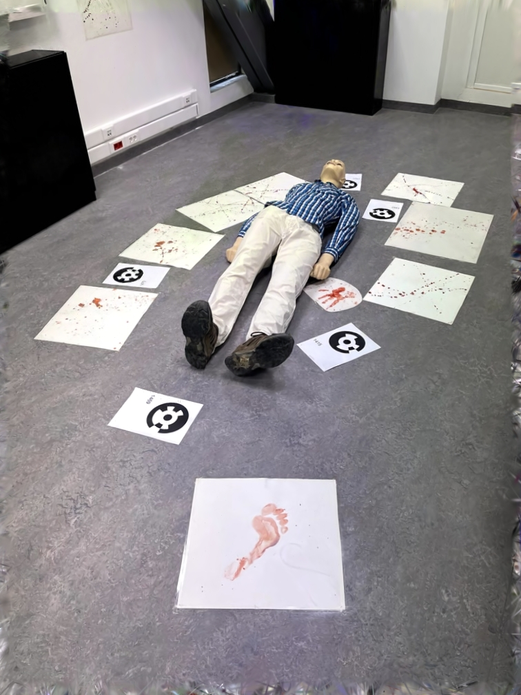
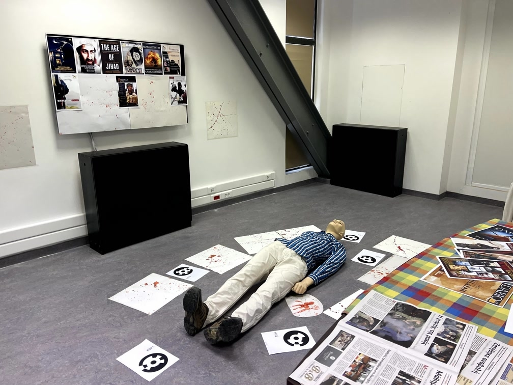

# Localized failure-mode inspection — `galanakis2021`, post-cleanup checkpoint (Task 7)

Visual inspection of the final, working reconstruction — Task 5's pruned
checkpoint (`outputs/colmap_pruned/splatfacto/2026-08-24_010039/`,
454,084 Gaussians) — looking for **where quality visibly degrades within a
reconstruction that otherwise succeeded**, not the already-documented
whole-scene haziness (`cleanup.md`'s PSNR ~12 across the pinned 18/2 eval
split). No new training, no new COLMAP runs — this uses the checkpoint that
already exists. Visual inspection and documentation only, no parameter
changes.

## Method

`cleanup.md`'s before/after pair used exactly one fixed eval viewpoint. That
isn't enough to see *where* in the scene things go wrong versus *whether*
they go wrong overall, so this task renders every camera the checkpoint
actually has — not a synthetic flythrough, not a new camera path, the real
train+eval poses from the pinned COLMAP reconstruction:

```
python pipelines/image/scripts/render_checkpoint.py dataset \
  --load-config outputs/colmap_pruned/splatfacto/2026-08-24_010039/config.yml \
  --output-path <renders>/ \
  --split train+test \
  --rendered-output-names rgb gt-rgb
```

(New wrapper script, `render_checkpoint.py` — same `weights_only=False`
pattern as `eval_checkpoint.py`, needed because `ns-render` hits the same
PyTorch 2.6+ checkpoint-loading gotcha documented in the main README.)
Checkpoint reload confirmed the same way as every other task this session:
`✅ Done loading checkpoint from
outputs/colmap_pruned/splatfacto/2026-08-24_010039/nerfstudio_models/step-000029999.ckpt`.
Rendered **all 20 registered images** — 18 train + 2 eval — each as both
`rgb` (the model's render) and `gt-rgb` (the real photo at that pose, for
direct comparison), so every finding below is checked against the actual
photograph, not against a subjective sense of what looks "off."

**Registered-image gaps, relevant to the coverage-edge finding below**: per
`colmap_config.md`, this checkpoint's COLMAP run registered 20 of 30 source
images — frames 1–9, 13–14, 20–25, 28–30 registered; **frames 10–12, 15–19,
and 26–27 were never registered at all** (no recovered camera pose, so no
training supervision from that part of the capture sequence). Frames
immediately after a gap are the ones with the least surrounding multi-view
support.

Inspected 7 of the 18 train views (spread across the sequence, including
frames immediately before/after each registration gap) plus both of the 2
eval views (already covered in `cleanup.md`, re-checked here rather than
re-analyzed from scratch).

## Finding 1 — Peripheral chromatic-noise artifact at frame edges (frustum-edge floaters)

**What's wrong**: a band of rainbow/prism-colored streaking noise along the
outer edges of the rendered frame — visible as colorful diagonal smears
intruding from the image border, absent from the real photo at the exact
same camera pose.

**Where**: present, to varying degrees, in **5 of the 7 train views
inspected** (`frame_00001`, `frame_00014`, `frame_00021`, `frame_00022`,
`frame_00024`) — not one isolated viewpoint, a recurring pattern. Two
examples, render vs. the real photo at the same pose:

**`frame_00014`** (most pronounced — a full rainbow border on all four sides):

| Rendered | Ground truth |
|---|---|
|  |  |

**`frame_00001`** (visible as colored streaking down the left/right edges):



**Best guess why (not independently verified — flagged as a guess)**: this
looks like the classic 3DGS/Splatfacto frustum-periphery floater pattern —
Gaussians with poorly-constrained, erratic view-dependent color (spherical
harmonics) that sit just inside a camera's field of view but near its edge,
where fewer overlapping training rays from *other* cameras converge to
constrain them (neighboring cameras' frustums generally overlap strongly
near the center of a shared view but overlap less toward each camera's own
edge). This would explain why it shows up at frame *borders* specifically
and across many different viewpoints rather than one specific scene
location — it's a property of how thoroughly each pixel's line of sight is
constrained by other views, not a property of one particular object or
surface in the room. Not chased further to confirm (e.g. no per-pixel
multi-view ray-count analysis was run) — reported as the most plausible
explanation given the pattern, not a confirmed root cause.

## Finding 2 — Floating, geometrically wrong blob adjacent to a real registration gap

**What's wrong**: an inverted, warped, shoe-like brown smear floating in
mid-air at the bottom-right of the frame, with no corresponding object in
the real photo at that pose.

**Where**: `frame_00021` — the first registered frame immediately after the
**frames 15–19 registration gap** (5 consecutive unregistered source
images, per `colmap_config.md`).

| Rendered | Ground truth |
|---|---|
|  |  |

The rest of this frame — the door, the posed mannequin, the wall, the
checkered tablecloth of documents — reconstructs cleanly and matches the
photo closely. It's specifically the bottom-right region, where the real
photo shows plain tablecloth/documents, that the render fabricates a
floating warped shape.

**Best guess why (flagged as a guess)**: this frame sits directly against a
real, documented coverage gap — 5 consecutive source images with no
recovered pose, meaning no training supervision from that stretch of the
capture path. A plausible mechanism: some Gaussians in that image region
were constrained by relatively few surviving neighboring views (the ones
that exist on either side of the gap, at unusually wide baseline compared
to the normal frame-to-frame spacing elsewhere), letting geometry that
should be flat/absent drift into a warped floating shape that happens to
resemble a nearby real object (a shoe appears elsewhere in this same
scene). Genuinely a guess — no ray-coverage count was computed for this
specific region to confirm sparse local support is the actual cause rather
than something else entirely (e.g. a genuine SfM point-cloud outlier
surviving initialization). Worth naming as the most plausible explanation
given where it sits, not as a verified diagnosis.

## Checked, nothing distinct found: reflective/glossy surfaces and thin forensic detail

The task asked specifically to look for two more known 3DGS failure
categories. Checked both, honestly reporting a negative result for both —
not forcing a third dramatic finding that isn't there:

- **Reflective/glossy surfaces**: the scene's most plausible candidate is
  the black cabinet units (matte-to-semi-gloss laminate, in most frames)
  and a window with visible glass (`frame_00021`/`frame_00024`
  background). Compared render vs. ground truth on both across the
  inspected frames — **no distinct localized degradation beyond the
  reconstruction's general softness**: no color-shifted specular blob, no
  view-dependent color instability specific to these surfaces relative to
  the rest of the frame. Plausible reading: nothing in this scene is glossy
  enough (no mirrors, no polished metal, no glass close to camera) to
  trigger the sharp view-dependent specular failures 3DGS literature
  usually flags — a real absence, not a missed check.
- **Thin/small forensic detail** (evidence marker cards, blood-spatter
  sheets — the category that matters most for this project's actual use
  case): inspected closely across every train view checked. The flat
  marker cards and the fine dot patterns of the blood-spatter sheets stay
  legible and comparably sharp to the surrounding floor/wall texture in
  every train view — **no distinct thin-geometry collapse found**,
  separate from the two eval views' overall haze (below). Consistent with
  `cleanup.md`'s finding that pruning barely changed anything: these are
  flat, near-planar surfaces lying on the floor, well inside the region the
  camera path walked closely around, so they get strong multi-view
  constraint from many nearby frames — the opposite geometric situation
  from Finding 2's floating blob.

## Re-confirmed, not re-analyzed: the eval-view haze is the same finding as `cleanup.md`

Rendered both eval (novel-viewpoint) images for completeness. `frame_00029`
(eval) is dramatically degraded — large wispy, fern-like floater streaks
occluding most of the frame, matching the general low-PSNR (~12) finding
`cleanup.md` already documented and measured. This is **the same
already-known whole-reconstruction quality ceiling** (18-image training set,
per `splatfacto_config.md`'s sparse-view findings) showing up again, not a
new distinct failure zone — flagged here explicitly so it isn't
double-counted as a new finding.

## Reading this honestly

**Two concrete, distinct, image-evidenced localized failures exist inside
an otherwise-successful reconstruction** — a recurring frustum-edge
chromatic artifact (Finding 1, seen in most inspected views) and a
gap-adjacent floating geometry blob (Finding 2, tied to a specific,
already-documented registration gap). Both are visible in *train* views —
frames the model was directly supervised on — which makes them more
informative about *where* geometry is weak than the eval views (already
known to be uniformly poor). Two other commonly-flagged 3DGS failure
categories (reflective surfaces, thin forensic detail) were checked and
genuinely didn't show a distinct localized problem in this scene — reported
as a real negative result, not a gap in the inspection.

## What's still open

- **Root causes for both findings are best-guess, not verified.** Neither
  was chased into a quantitative check (e.g. counting overlapping training
  rays per pixel, or inspecting which specific Gaussians contribute to the
  blob in Finding 2) — out of scope for a visual-inspection task per this
  task's own scope line.
- **Only 7 of 18 train views were inspected closely**, chosen to cover the
  sequence and every registration-gap boundary — not all 18. The two
  findings' prevalence (5/7 for Finding 1) is a real count over what was
  checked, not a claim about the full set.
- No parameter changes, no retraining, no new COLMAP runs were made — per
  this task's explicit scope. Whether either failure mode would respond to
  a training change (longer training, denser initialization near gaps,
  etc.) is unknown and untested here.
